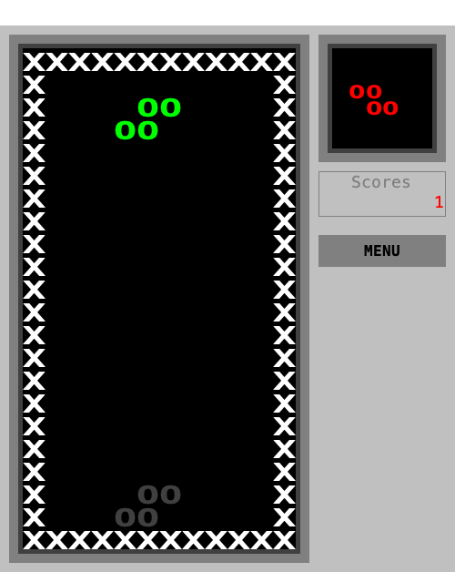

# SeoulTech SE Tetris

Java Swing으로 만든 소프트웨어공학 팀 프로젝트.
Classic·Item 모드, 3단계 난이도와 5종 아이템을 제공한다.

[실행 파일 다운로드](https://github.com/HoroyoiPeach/SeoulTech-SE-Tetris-Ref/releases) · [사용자 안내서](docs/user-guide.md) · [검증 보고서](docs/verification.md)

## 다운로드와 실행

**제출 환경: macOS 26 이상 · Apple Silicon**
배포 ZIP에는 Java 21 runtime이 포함돼 있어 별도 Java 설치가 필요 없다.

1. [Releases](https://github.com/HoroyoiPeach/SeoulTech-SE-Tetris-Ref/releases)에서 제출용 릴리스의 macOS ZIP을 받는다.
2. ZIP 전체를 압축 해제한다.
3. `SeoulTech Tetris.app`을 더블클릭한다.
4. `CLASSIC` 또는 `ITEM`을 선택한다.

정확한 제출 태그·실행 파일·SHA-256과 소스·검증 링크는 **해당 릴리스 본문**에서 확인한다.
현재 작업의 배포 순서는 [릴리스 안내](docs/release-notes.md)에 정리했다.



## 게임 기능

| 기능 | 내용 |
|---|---|
| Classic | 7종 블록으로 줄을 완성하는 기본 테트리스 |
| Item | 삭제 누계 10줄마다 L·O·C·B·P 아이템 공급 |
| 난이도 | Easy·Normal·Hard별 블록 등장 확률과 속도 증가 폭 |
| 설정 | 화면 크기 3종, 조작키 변경, 색상 모드 4종 |
| 기록 | All·Classic·Item 조회, 난이도 표시, 설정·기록 저장 |

B·C는 효과가 끝난 뒤 남은 칸들이 각 열에서 아래로 내려앉는다.
아이템별 모양·발동 조건·점수는 [게임 명세서](docs/specification.md)에서 확인할 수 있다.

| 동작 | 기본 키 |
|---|---|
| 좌우 이동 | ← / → |
| 회전 | ↑ |
| 한 칸 낙하 | ↓ |
| 하드드롭 | Space |
| 정지·재개 | P |
| 메뉴 이동·선택 | ↑ / ↓ · Enter |

기본 난이도는 Easy이며, 시작 메뉴의 `MENU`에서 설정을 변경한다.
게임 중 메뉴로 돌아가면 현재 게임은 종료되고 그 점수는 저장하지 않는다.

## 요구사항과 평가 자료

이 README와 아래 7개 문서가 제출용 정본이다.
기존 계획·점검 문서는 작업 이력으로 보관하며, 현재 동작과 판정은 정본을 기준으로 확인한다.

| 문서 | 확인할 내용 |
|---|---|
| [요구사항 1 체크리스트](docs/requirements-1-checklist.md) | 119개 요구사항별 상태 |
| [요구사항 2 체크리스트](docs/requirements-2-checklist.md) | 85개 요구사항별 상태 |
| [게임 명세서](docs/specification.md) | 게임 규칙·점수·난이도·5종 아이템 |
| [사용자 안내서](docs/user-guide.md) | 실행·조작·설정·아이템·순위 |
| [개발 안내서](docs/development.md) | 개발 환경·빌드·테스트·패키징·확장 방법 |
| [검증 보고서](docs/verification.md) | 실제 검사 결과·분포 그래프·원본 증빙·인수 기록 |
| [프로젝트 관리 기록](docs/project-management.md) | 팀원 업무·PR·Issue·주요 결정 |

[204개 요구사항 증빙 색인](docs/evidence/requirements-status-20261026.csv)에서 구현·테스트·결과를 함께 확인할 수 있다.

## 자동검증

제품 소스 `154fd09`의 macOS 로컬 검증 결과다.
원본과 실행 환경, 검사 범위는 [검증 보고서](docs/verification.md)에 기록했다.

| 항목 | 결과 |
|---|---|
| JUnit | 98개 통과 |
| Line Coverage | 1,534 / 1,703 = **90.08%** |
| 일반 블록 분포 | 난이도별 100,000회 · 21개 조합 통과 |
| 아이템 분포 | 100,000회 · 5종 통과 |
| GUI 자동검사·Mac 패키징 | 통과 |

## 소스로 실행

JDK 21을 준비하고 저장소 루트에서 실행한다.

```bash
./gradlew --no-daemon --console=plain build
./gradlew run
```

최초 빌드에는 Gradle과 의존성을 내려받을 네트워크가 필요하다.
GUI 검사·패키징 명령은 [개발 안내서](docs/development.md)를 참고한다.
