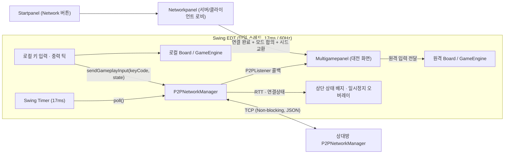
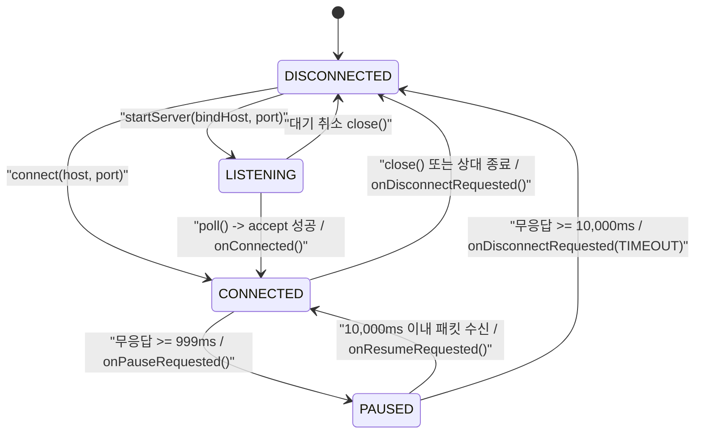
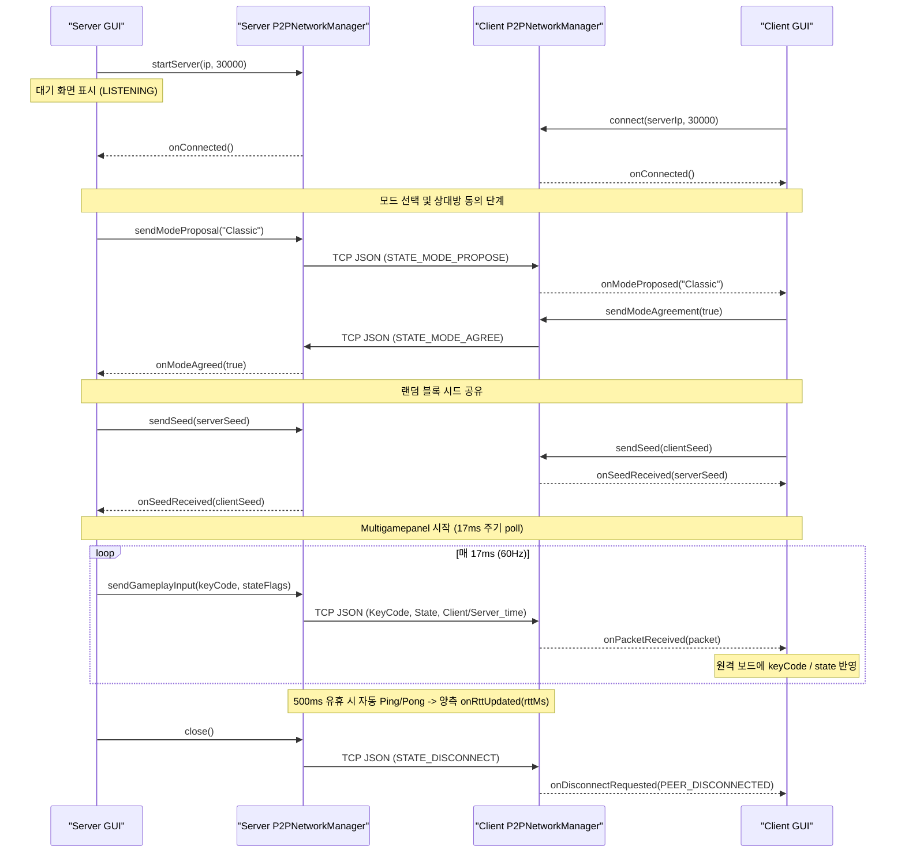

# `P2PNetworkManager` 그래픽 인터페이스(GUI) 연동 명세서

작성: 2026-11-23 · 대상 모듈: `seoultech.se.tetris.network`

이 문서는 Java Swing 기반 게임 화면(`Startpanel`, `Networkpanel`, `Multigamepanel`)에서 [P2PNetworkManager](../src/main/java/seoultech/se/tetris/network/P2PNetworkManager.java)를 연결해 사용하기 위한 **화면 흐름, 상태 전이, UI 배치, 이벤트 매핑 및 Swing EDT 연동 규칙**을 정의한다.

---

## 1. 전체 GUI–네트워크 연동 아키텍처

`P2PNetworkManager`는 Swing 컴포넌트나 `GameEngine`을 직접 참조하지 않는다. 모든 연동은 **Swing EDT(Event Dispatch Thread)** 상에서 `javax.swing.Timer(17ms)`의 `poll()` 호출과 `P2PListener` 콜백으로만 이루어진다.



---

## 2. 연결 상태 머신 (`P2PConnectionState`) 및 Exception Flow

GUI는 `P2PNetworkManager.getConnectionState()`와 `P2PListener` 콜백을 기준으로 화면 오버레이와 게임 진행 상태를 제어한다.



| 상태 / 콜백 | GUI 화면 동작 |
|---|---|
| `LISTENING` | 서버 대기 화면 표시 (`내부 IP : 30000` 표시, 취소 버튼 활성화) |
| `onConnected()` | 로비 모드 선택 화면으로 전환 |
| `CONNECTED` | 정상 게임 진행, 상단 배지에 `CONNECTED` 및 `RTT (ms)` 표시 |
| `onPauseRequested(silenceMs)` | **즉시 로컬/원격 게임 타이머 정지**, 반투명 오버레이 `"상대방 응답 대기 중... (재연결 대기)"` 표시 |
| `onResumeRequested()` | 일시정지 오버레이 제거, **게임 타이머 재개** |
| `onDisconnectRequested(reason)` | 폴링 타이머 및 게임 중지, 사유별 안내 다이얼로그(`TIMEOUT` / `PEER_DISCONNECTED` / `IO_ERROR`) 표시 후 `Networkpanel` 또는 `Startpanel`로 복귀 |

---

## 3. Normal Flow 시퀀스 (로비 → 게임 진행 → 종료)



---

## 4. 화면별 그래픽 인터페이스 명세

### 4.1 `Startpanel` 진입점

- 기존 메뉴 버튼(`CLASSIC`, `ITEM`, `SCORE`, `MENU` 등)에 **`NETWORK`** 버튼을 추가한다.
- 클릭/Enter 시 `Maincontainer`에 `Networkpanel` 전환을 요청한다.

### 4.2 `Networkpanel` (로비 화면)

#### (1) 역할 선택 및 연결 화면

```text
+------------------------------------------------------+
|                 P2P NETWORK BATTLE                   |
|                                                      |
|   [  SERVER (방 만들기)  ]   [  CLIENT (접속하기)  ]   |
|                                                      |
|  --- SERVER 선택 시 ---       --- CLIENT 선택 시 ---   |
|  내 내부 IP: 192.168.x.x      서버 IP: [ 192.168.__ ] |
|  포트 번호 : 30000            포트   : [ 30000      ] |
|  상태      : 접속 대기 중...   최근 IP: [192.168.0.5 ] |
|  [ 대기 취소 ]                [ 접속 ]  [ 뒤로 ]      |
+------------------------------------------------------+
```

| UI 요소 | 호출 메서드 / 데이터 출처 | 비고 |
|---|---|---|
| `내 내부 IP` 라벨 | `P2PNetworkManager.resolveLocalInternalIp()` | 서버가 상대에게 공유할 내부 IP 표시 |
| `SERVER` 시작 버튼 | `p2p.startServer(30000)` 또는 `startServer(bindIp, 30000)` | 17ms `Swing Timer`로 `p2p.poll()` 시작 |
| `CLIENT` 접속 버튼 | `p2p.connect(host, port)` | 실패(`IOException`) 시 오류 메시지 라벨 표시 |
| `대기 취소` / `뒤로` | `pollTimer.stop(); p2p.close();` | 소켓 및 타이머 즉시 해제 |

#### (2) 모드 선택 및 상대방 동의 대기 화면

```text
+------------------------------------------------------+
|            CONNECTED (RTT: 4.2 ms)                   |
|                                                      |
|   모드 선택 (서버): (o) Classic  ( ) Item  ( ) Time   |
|   상대방 상태     : [ 동의 대기 중 / 동의 완료 ]       |
|                                                      |
|   (클라이언트 측 표시)                                 |
|   제안된 모드: Classic        [ 동의 ]   [ 거절 ]     |
+------------------------------------------------------+
```

| 동작 | 호출 메서드 | 수신 콜백 |
|---|---|---|
| 서버가 모드 확정 | `p2p.sendModeProposal(modeName)` | 클라이언트: `onModeProposed(mode)` |
| 클라이언트가 동의/거절 | `p2p.sendModeAgreement(true / false)` | 서버: `onModeAgreed(agreed)` |
| 양측 합의 완료 시 | 양측 모두 `p2p.sendSeed(mySeed)` 호출 | 상대방: `onSeedReceived(peerSeed)` |
| 시드 수신 완료 시 | `Multigamepanel` 생성 (내 시드 + 상대 시드 전달) | 게임 루프 시작 |

---

### 4.3 `Multigamepanel` (대전 게임 화면)

```text
+-------------------------------------------------------------------+
|  MODE: Classic   |   NET: CONNECTED   |   RTT: 6.4 ms   | [MENU]  |
+-------------------------------------------------------------------+
|  +------------------+   +----+   +------------------+             |
|  |                  |   |공격|   |                  |  [NEXT]     |
|  |   LOCAL BOARD    |   |대기|   |   REMOTE BOARD   |  +------+   |
|  |  (내 키 입력)     |   |10줄|   | (소켓 패킷 입력)  |  |      |   |
|  |                  |   |스택|   |                  |  +------+   |
|  |                  |   |    |   |                  |  SCORE:     |
|  +------------------+   +----+   +------------------+  001200     |
+-------------------------------------------------------------------+
|  [예외 발생 시 중앙 반투명 오버레이]                                  |
|   PAUSED: 상대방 응답 없음 (999ms 초과) — 최대 10초 대기 중...        |
+-------------------------------------------------------------------+
```

#### 데이터 송신 규칙 (로컬 → 소켓)

로컬 플레이어의 키 입력 또는 중력 낙하로 블록 동작이 발생할 때마다 즉시 패킷을 전송한다.

| 로컬 이벤트 | 전송 코드 |
|---|---|
| 좌/우/하/회전/하드드롭 이동 | `p2p.sendGameplayInput(keyCode, P2PPacket.STATE_NONE)` |
| 블록 고정 및 다음 블록 전환 | `p2p.sendGameplayInput(keyCode, P2PPacket.STATE_CURR_CHANGED)` |
| 블록 고정 + 레벨업 동시 발생 | `p2p.sendGameplayInput(keyCode, P2PPacket.STATE_CURR_CHANGED \| P2PPacket.STATE_LEVEL_UP)` |
| 로컬 게임오버 발생 | `p2p.sendGameplayInput(0, P2PPacket.STATE_GAME_OVER)` |

> **참고**: `sendGameplayInput(...)`을 호출하면 500ms 유휴 하트비트 타이머가 자동으로 초기화된다. 별도로 빈 패킷을 수동 전송할 필요가 없다.

#### 데이터 수신 규칙 (소켓 → 원격 보드)

매 17ms(60Hz)마다 `p2p.poll()`을 호출하면 수신된 유효 게임 패킷이 FIFO 순서로 `onPacketReceived(P2PPacket packet)` 및 `poll()` 반환 리스트로 전달된다.

- `packet.keyCode()`: 원격 보드에 전달할 키코드 (`VK_LEFT`, `VK_RIGHT`, `VK_UP`, `VK_DOWN`, `VK_SPACE` 등)
- `packet.hasState(P2PPacket.STATE_CURR_CHANGED)`: 상대 블록 고정/전환 동기화 확인
- `packet.hasState(P2PPacket.STATE_LEVEL_UP)`: 상대 레벨업 상태 확인
- `packet.hasState(P2PPacket.STATE_GAME_OVER)`: 상대 게임오버 판정 트리거
- `packet.timestamp()`: 상대 세션 기준 경과 시간(ms, `float`)

---

## 5. Swing EDT 연동 코드 예시

```java
P2PConfig config = P2PConfig.defaults(); // 17ms poll, 500ms heartbeat, 999ms pause, 10000ms disconnect

P2PListener listener = new P2PListener() {
    @Override
    public void onConnected() {
        showModeSelectionScreen();
    }

    @Override
    public void onModeProposed(String mode) {
        updateProposedModeLabel(mode);
    }

    @Override
    public void onModeAgreed(boolean agreed) {
        if (agreed) {
            p2p.sendSeed(localSeed);
        }
    }

    @Override
    public void onSeedReceived(long peerSeed) {
        startMultiGameIfReady(localSeed, peerSeed);
    }

    @Override
    public void onPacketReceived(P2PPacket packet) {
        remoteBoard.applyRemoteInput(packet.keyCode(), packet.state());
    }

    @Override
    public void onRttUpdated(float rttMillis) {
        rttLabel.setText(String.format("RTT: %.1f ms", rttMillis));
    }

    @Override
    public void onPauseRequested(long silenceMillis) {
        pauseLocalAndRemoteTimers();
        showNetworkPauseOverlay("상대방 응답 대기 중...");
    }

    @Override
    public void onResumeRequested() {
        hideNetworkPauseOverlay();
        resumeLocalAndRemoteTimers();
    }

    @Override
    public void onDisconnectRequested(P2PDisconnectReason reason) {
        pollTimer.stop();
        stopGameAndShowDisconnectDialog(reason);
    }
};

P2PNetworkManager p2p = new P2PNetworkManager(config, listener);

// 60Hz (17ms) 단일 스레드 폴링 타이머 — Swing EDT에서 실행
javax.swing.Timer pollTimer = new javax.swing.Timer((int) config.pollIntervalMs(), e -> {
    p2p.poll();
});
pollTimer.start();
```

---

## 6. 구현 시 필수 준수 사항

1. **단일 스레드(EDT) 호출 원칙**: `P2PNetworkManager`의 `poll()`, `send*()`, `close()`는 모두 Swing EDT에서 직렬 호출한다. 별도 수신 스레드를 만들지 않는다.
2. **화면 이탈 시 리소스 정리**: `Multigamepanel`이나 `Networkpanel`에서 메뉴로 돌아가거나 창을 닫을 때 반드시 `pollTimer.stop()` 후 `p2p.close()`를 호출하여 포트(`30000`)와 소켓을 즉시 반환한다.
3. **종료 후 재사용 금지**: `DISCONNECTED` 상태가 된 연결을 다시 시작할 때는 새 `P2PNetworkManager`를 생성하거나 `startServer()` / `connect()`를 새로 호출한다.
4. **클라이언트 접속 블로킹 주의**: `connect(host, port, connectTimeoutMs)`는 최초 TCP 핸드셰이크 동안 최대 `connectTimeoutMs`만큼 대기할 수 있으므로, 외부 IP(NAT) 접속 시 UI 프리징을 피하려면 접속 시도 단계만 `SwingWorker`로 실행하고 연결 완료(`onConnected`) 이후의 모든 `poll()`/`send*()`는 EDT에서 수행하는 것을 권장한다.
