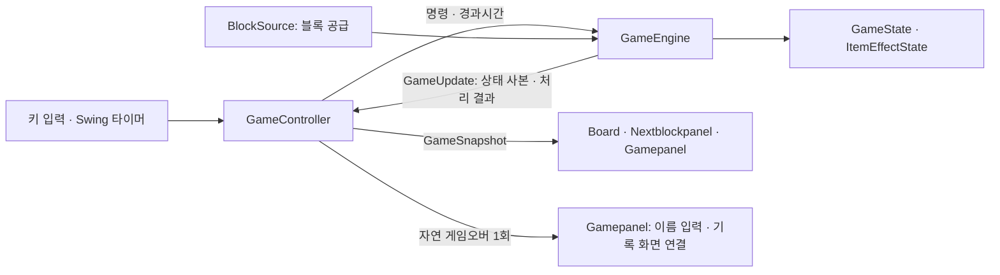

# 리팩토링 이후 개발 가이드

**게임 규칙은 Engine, 입력·시간 진행은 Controller, 화면 표현은 View에서 개발한다.**

Classic/Item 1인 게임을 담당하는 Java Swing 프로젝트다. 이번 리팩토링은 기존 규칙·설정·기록 저장 흐름을 유지하면서, Board에 모여 있던 책임을 분리한 작업이다.

## 1. 어디서 이어서 개발하나

| 항목 | 기준 |
|---|---|
| 최종 통합 브랜치 | `refactor/rf05-06-integration` |
| 개발 시작 기준 | 원격 게시 후 팀이 확정한 통합 브랜치의 최신 커밋. 이 가이드까지 포함한 커밋 SHA를 함께 공유 |
| 구현 완료 시점 기록 | `b58a33b` — RF-06 구현·검증 완료 시점. 후속 MENU 입력 수정은 [별도 검증 기록](native-focus-fix.md) 참고 |
| 단계별 브랜치 | RF-01·02 → RF-03·04 → RF-05·06 순서로 누적 |
| 공유 상태 | 현재 로컬 커밋 완료. 원격 브랜치 게시·PR·팀 리뷰는 아직 진행 전 |
| 구현 범위 | Classic/Item 1인 게임, 엔진 두 개의 독립 실행 검증 |
| 다음 개발 범위 | 실제 대전·공격·P2P·재대전·연결 장애 처리 |

팀 개발을 시작할 때는 원격에 게시된 최종 통합 브랜치와 팀이 합의한 기준 커밋에서 기능 브랜치를 만든다. PR 생성은 현재 사용자 요청으로 보류 중이다.

## 2. 구조가 어떻게 달라졌나

| 기존 | 현재 |
|---|---|
| Board에 게임 상태·규칙·타이머·화면 표시가 집중 | GameEngine이 상태·규칙, GameController가 입력·시간, Board가 표시 담당 |
| 화면과 게임 계산이 얽혀 규칙 확인에도 UI 준비 필요 | 엔진에 명령과 경과시간을 넣어 화면 없이 검사 가능 |
| Board 내부 구조를 참조하는 테스트가 많음 | 규칙·Controller·화면 테스트를 각각의 책임에 맞게 배치 |

이번 범위는 게임 진행 부분의 **MVC식 책임 분리**다. Gamepanel은 화면 조립·일시정지 UI·이름 입력·기록 화면 연결을 계속 담당한다.



실행 흐름: **키 입력 → Controller → Engine 계산 → 상태 사본 → 화면 갱신**.

## 3. 기능별 수정 위치

| 하려는 작업 | 먼저 볼 코드 | 확인할 테스트 |
|---|---|---|
| 이동·회전·충돌·점수·줄 삭제 수정 | [GameEngine](../../src/main/java/seoultech/se/tetris/game/GameEngine.java)의 `handle`, `moveHorizontal`, `lockCurrent`, `removeRows`와 기존 `CollisionRules` | [GameEngineCoreTest](../../src/test/java/seoultech/se/tetris/game/GameEngineCoreTest.java), [GameEngineParityTest](../../src/test/java/seoultech/se/tetris/game/GameEngineParityTest.java) |
| 아이템 효과·공급 수정 | [GameEngine](../../src/main/java/seoultech/se/tetris/game/GameEngine.java)의 `lockCurrent`, `advanceItemEffect`, `continueAfterLock`, [ItemEffectState](../../src/main/java/seoultech/se/tetris/game/ItemEffectState.java) | [GameEngineItemTest](../../src/test/java/seoultech/se/tetris/game/GameEngineItemTest.java), [GameEngineEffectTest](../../src/test/java/seoultech/se/tetris/game/GameEngineEffectTest.java) |
| 입력 연결·타이머·시작·종료 수정 | [GameController](../../src/main/java/seoultech/se/tetris/component/GameController.java)의 `handleKey`, `dispatch`, `start`, `stop` | [GameControllerLifecycleTest](../../src/test/java/seoultech/se/tetris/component/GameControllerLifecycleTest.java), [GameControllerTimingTest](../../src/test/java/seoultech/se/tetris/component/GameControllerTimingTest.java) |
| 보드·고스트·효과의 모양 수정 | [Board](../../src/main/java/seoultech/se/tetris/component/Board.java)의 `paintComponent`, `drawGhost`, `drawEffect` | [BoardRenderingTest](../../src/test/java/seoultech/se/tetris/component/BoardRenderingTest.java) |
| 다음 블록·점수·일시정지·이름 입력 UI 수정 | [Gamepanel](../../src/main/java/seoultech/se/tetris/component/Gamepanel.java), [Nextblockpanel](../../src/main/java/seoultech/se/tetris/component/Nextblockpanel.java) | 관련 component 테스트와 `desktopSmoke` |
| 블록 공급 방식 수정 | [BlockSource](../../src/main/java/seoultech/se/tetris/game/BlockSource.java), [GeneratorBlockSource](../../src/main/java/seoultech/se/tetris/game/GeneratorBlockSource.java), 기존 `BlockGenerator` | [BlockGeneratorConsumptionTest](../../src/test/java/seoultech/se/tetris/blocks/BlockGeneratorConsumptionTest.java), [GameEngineIsolationTest](../../src/test/java/seoultech/se/tetris/game/GameEngineIsolationTest.java) |

## 4. 코드를 읽을 때 따라갈 흐름

**시작:** `Maincontainer.exitStartEnterGame`에서 화면을 붙이고 표시한 뒤 `Gamepanel.startGame`을 호출한다. Gamepanel 생성 시 엔진·공급원·Controller를 조립하지만 실제 게임은 `GameEngine.start()`에서 시작한다.

**왼쪽 이동:** `Gamepanel.PlayerKeyListener` → `GameController.handleKey` → `dispatch(LEFT)` → `GameEngine.handle` → `moveHorizontal(-1)` 순서다. Controller는 명령 직전에 경과시간을 먼저 정산한다.

**화면 반영:** 엔진이 반환한 [GameUpdate](../../src/main/java/seoultech/se/tetris/game/GameUpdate.java)를 Controller의 `consume`이 처리한다. `publish`가 [GameSnapshot](../../src/main/java/seoultech/se/tetris/game/GameSnapshot.java)을 Board와 Gamepanel에 전달한다. Board는 사본을 보관하고 `repaint()`한다.

**블록 고정:** `GameUpdate.lockResolution()`이 있으면 현재 1인 Controller는 그 `turnId`로 `continueAfterLock`을 한 번 호출한다. 이때 다음 블록의 등장 충돌을 확인하고 새 블록을 공급한다. 이 단계를 누락하면 `AWAITING_SPAWN` 상태에서 다음 블록이 나오지 않는다.

## 5. 다음 기능을 붙일 때 지킬 규칙

- **상태 소유권:** `GameState`는 엔진 내부 상태다. UI·통신 코드에서 직접 수정하지 않는다. 외부에서는 명령을 전달하고 불변 `GameSnapshot`을 읽는다.
- **호출 순서:** 한 엔진은 한 실행 흐름에서 순서대로 호출한다. 현재 UI는 Swing의 이벤트 처리 스레드인 EDT를 사용한다. 향후 네트워크 수신 스레드가 엔진을 동시에 호출하게 만들지 않는다.
- **시간:** 엔진에는 `advance(elapsedNanos)`로 경과시간을 전달한다. 엔진에 Swing Timer·실제 시계·`sleep`을 추가하지 않는다. 현재 지연 처리 규칙은 호출 한 번당 중력 또는 아이템 프레임을 최대 한 번 진행하는 방식이다.
- **시작·종료:** 생성과 시작을 구분하고, 종료된 게임을 다시 할 때는 새 엔진을 만든다. 메뉴 이탈은 즉시 `stop`하며 자연 게임오버의 이름 입력·기록 흐름과 구분한다.
- **블록 공급:** 각 엔진에 독립적인 공급원을 주고, 매번 새 Block 객체를 반환한다. 한 Block 인스턴스를 여러 엔진에서 공유하지 않는다.
- **변경 범위:** 화면 변경은 View에서, 규칙 변경은 Engine에서 시작한다. 명령·상태 사본 형식을 바꾸면 관련 테스트와 [엔진 계약](game-engine-contract.md)도 함께 갱신한다.

### 예시: 이동 규칙을 바꾸는 작업

1. PDF와 합의한 변경 규칙을 확인한다.
2. [GameEngineCoreTest](../../src/test/java/seoultech/se/tetris/game/GameEngineCoreTest.java)의 `movementRotationAndHardDropUseFixedGridWithoutMutatingIt`을 참고해, 바뀌어야 할 상황의 기대 결과를 테스트로 추가한다.
3. `GameEngine.moveHorizontal`과 필요 시 `CollisionRules`를 수정한다. Board에서 좌표를 직접 바꾸지 않는다.
4. 관련 엔진 테스트 후 전체 `check build`를 실행한다. 화면·입력에도 영향이 있으면 데스크톱 검사까지 확인한다.

테스트의 [GameEngineFixture](../../src/test/java/seoultech/se/tetris/game/GameEngineFixture.java)는 블록과 시작 상태를 고정한다. 난수나 실제 대기시간에 기대지 않고 같은 상황을 반복 검사할 수 있다. 내부 상태를 직접 설정하는 이 방식은 테스트 준비용이다.

## 6. 실행과 확인 방법

저장소 루트에서 **JDK 21**로 실행한다. Windows에서는 `./gradlew` 대신 `gradlew.bat`를 사용한다.

```bash
# 게임 실행
./gradlew run

# 규칙 변경 중 빠르게 확인
./gradlew test --tests 'seoultech.se.tetris.game.GameEngineCoreTest'

# 통합 전 전체 검사·커버리지·빌드
./gradlew --no-daemon --console=plain check build

# 화면이 있는 환경에서 실제 창 확인
./gradlew --no-daemon --console=plain desktopSmoke
./gradlew --no-daemon --console=plain desktopFocusSmoke --args=swing
```

테스트 결과는 `build/reports/tests/test/index.html`, 커버리지는 `build/reports/jacoco/test/html/index.html`에서 확인한다. `check`의 Line Coverage 기준은 70%다.

**RF-06 마지막 검증 기록:** JUnit 153개 통과, 별도 JVM UI·설정·저장 검사 33개 통과, Line Coverage 90.59%, 빌드·desktopSmoke·합성 입력 포커스 검사 통과. 이는 당시 결과이며 기능 수정 후에는 다시 검사한다.

**후속 수정:** 게임 조작에 문자 조합이 개입하지 않도록 수정했고 JUnit 155개와 빌드가 통과했다. 기존 native MENU 실패의 실제 입력 재검사는 대기 중이다. [수정 내용·최신 검증](native-focus-fix.md)을 확인한다. `desktopFocusSmoke`를 인자 없이 실행하면 실제 마우스·키보드를 사용하므로 실행 시간을 사용자와 먼저 맞춘다. 위 `--args=swing` 검사는 별도 방식이다.

## 7. 대전 개발을 시작할 때

현재 검증한 것은 **두 엔진의 상태·입력·효과·공급이 서로 간섭하지 않는다는 점**이다. 로컬 2인 플레이·P2P 동기화·통신 지연 대응을 검증한 것은 아니다.

대전 조정 계층인 MatchEngine과 통신 계층은 후속 설계 대상이다. 현재 GameController는 Swing 화면을 직접 참조한다. 대전에서 재사용할 핵심은 GameEngine과 명령·상태 사본의 경계이며, 통신 방식과 대전 규칙은 PDF에 맞춰 별도로 확정한다. Snapshot JSON 예시는 표시 데이터 설명용이며 통신 프로토콜 구현은 아니다.

## 참고 자료

- [엔진 계약과 보존할 동작](game-engine-contract.md)
- [단계별 브랜치 구성·PR 보류 방침](delivery-plan.md)
- [기존 테스트 대응표](rf01-test-migration.csv)
- [RF-05/06 검증 기록](rf05-06-verification.md) · [MENU 입력 후속 수정·최신 검증](native-focus-fix.md)
