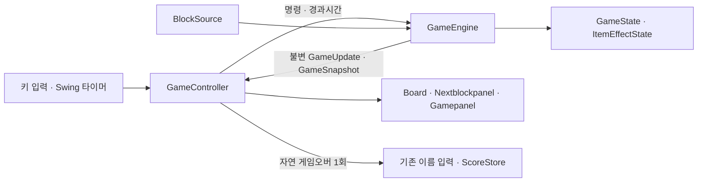

# 일반 리팩토링 구현 안내

**게임 계산은 엔진, 입력·시간 진행은 Controller, 화면은 상태 사본을 받아 그리는 View가 맡는다.** 기존 Classic/Item 1인 게임의 규칙·설정·기록 저장을 유지한다.

| 위치 | 책임 |
|---|---|
| `game/GameEngine` | 이동·충돌·고정·줄 삭제·점수·레벨·아이템·종료 판정 |
| `game/GameState`, `ItemEffectState` | 한 게임이 소유하는 가변 상태와 효과 진행 |
| `game/GameSnapshot`, `GameUpdate` | 화면에 전달할 불변 값과 고정·종료 결과 |
| `component/GameController` | 키 변환, 단일 타이머, 엔진 호출 순서, 화면 반영 |
| `component/Board`, `Nextblockpanel` | 상태 사본 그리기 |
| `component/Gamepanel` | 화면 구성, pause·이름 입력·기록 화면 연결 |

이전 Board의 게임 계산·여러 타이머·아이템 대기 루프를 제거했다. 게임 생성과 시작을 분리했고, 종료된 세션은 입력이나 늦은 타이머 호출로 다시 진행되지 않는다. 테스트는 실제 시간을 기다리는 대신 엔진에 경과시간을 주어 효과 경계를 검사할 수 있다.

엔진마다 상태와 블록 공급원이 독립적이다. 두 엔진의 입력·pause·효과·종료·공급이 서로 간섭하지 않는지 검증한다. 이는 향후 로컬/P2P 연결을 위한 기반이며, 실제 대전·공격·통신 구현은 포함하지 않는다.

- [엔진 계약과 보존할 동작](game-engine-contract.md)
- [3개 브랜치·PR 구성](delivery-plan.md)
- [기존 테스트 141개 항목의 현재 검증 위치](rf01-test-migration.csv)
- [RF-01 기준선](rf01-baseline.md) · [RF-02 검증](rf02-verification.md) · [RF-03/04 검증](rf03-04-verification.md) · [RF-05/06 검증과 native 검사 미해결 사항](rf05-06-verification.md)

JDK 21에서 `./gradlew clean check build`를 실행한다. 화면 확인은 `desktopSmoke`, 합성 입력의 실제 창 검사는 `desktopFocusSmoke --args=swing`으로 실행한다. native 입력 검사는 컴퓨터를 다른 용도로 조작하지 않는 동안 실행해야 결과를 구분할 수 있다.
