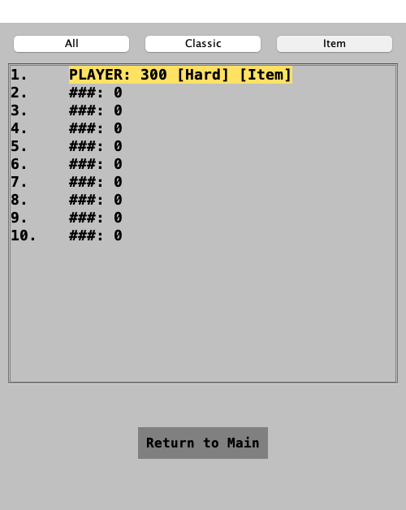
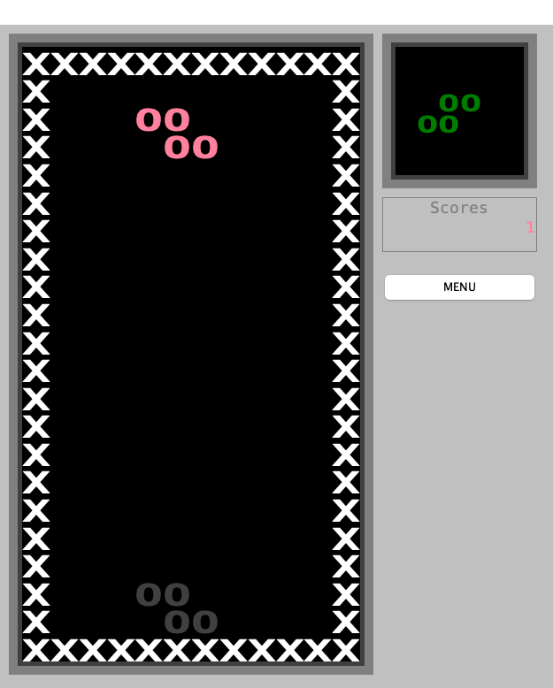

# R2-07 전체 통합 검증·평가 증빙 원장

2026-10-25 기준, 요구사항 2의 누적 기능과 기존 요구사항 1 회귀를 검증했다. **로컬 자동 검증·CI 아티팩트 대조·평가 자료는 준비됐고, R2-07 전체 완료는 보류한다.** PR 병합, 실제 대상 OS 인수, 최소 사양·장시간 플레이, GitHub Issue 등록 조건이 남아 있다.

| 구분 | 현재 결과 |
|---|---|
| 로컬 최종 검사 | `0412df9`에서 clean build·JUnit·회귀·coverage·보강 DesktopSmoke 통과 |
| 원격 제품 CI | `15e46ec`의 Windows Server 2025·macOS 26 모두 성공, 실제 아티팩트 대조 완료 |
| 이후 검사 보강 | 저장 키·Hard Item 기록·3개 창 크기/4팔레트 DesktopSmoke는 로컬에서만 실행. 이번 브랜치 푸시·PR·CI는 아직 미실행 |
| 배포 | 양 OS CI ZIP 무결성·구조 확인, 로컬 macOS 이미지 강제 재생성·실제 시작 창 확인 |
| 평가표 | [공통 빈 양식](evaluation-checklist.md) 90개를 [우리 팀 결과](evaluations/req2-2026-10-25.md)에 적용: 통과 72·부분 15·보류 3·실패 0. 자동/자료 판정 범위이며 공식 배점이 아님 |
| 기능 추적 | [요구사항 2 추적표](requirements-2-traceability.md): Q2 25개와 원본·보완 카드, 코드·검사 연결 |
| 인수 대기 | 아래 미완료 조건과 수동 양식. TEST-06/RELEASE-04를 자동 검사만으로 완료 처리하지 않음 |

## 1. 버전과 병합 순서

| 버전 | 용도 | 상태 |
|---|---|---|
| `dbb89684cb87f231fb411c513018e64c04e990b6` | PR #17 오류 수정까지 포함하는 main | main 반영 완료 |
| `d30cba3` / [PR #18](https://github.com/HoroyoiPeach/SeoulTech-SE-Tetris-Ref/pull/18) | 기존 기능 수용 검사 | 열림·병합 대기 |
| `3a2620d` / [PR #19](https://github.com/HoroyoiPeach/SeoulTech-SE-Tetris-Ref/pull/19) | 모드별 기록 완성 | 열림·병합 대기 |
| `15e46ec8ff6bfa530eb2da186bdc445517568e15` / [PR #20](https://github.com/HoroyoiPeach/SeoulTech-SE-Tetris-Ref/pull/20) | P·C/B·공급 완성, 원격 CI와 다운로드 패키지의 소스 | 열림·양 OS CI 성공·병합 대기 |
| `9688735` | 공통 평가 체크리스트 | 로컬 누적 브랜치 포함 |
| `0412df998051416bb75d66e3fa95e7917327bf65` | 저장 키·화면 구성·유한 설정 순환의 DesktopSmoke 보강 | 최종 로컬 clean 검사의 정확한 commit |

작업 브랜치는 `chore/req2-final-verification`다. `15e46ec`와 `0412df9`의 제품 `src/main` tree SHA는 모두 `e54da5673604115d39a5c070d4639dce27861885`이며 제품 코드·리소스와 빌드/패키징 규칙 변경은 없다. CI에서 확인한 제품과 이번 로컬 실행 제품은 같고, 테스트 보강과 문서는 구분한다.

PR #20의 GitHub 임시 merge commit `00ac8065a44f56e0f76401b41b3bddf4a8cada08`과 head `15e46ec`의 전체 tree도 `f972bcfb73acc4fc951d448e02cfdae36934b6ef`로 같음을 API로 대조했다. **임시 merge commit은 main 병합 완료가 아니다.** 최종 병합은 #18→#19→#20 순서이며, squash/rebase 병합으로 비교가 달라지면 원본 작업을 보존해 차이를 대조한다. 이후 이 최종 검증 브랜치도 리뷰하고, 확정 main SHA에서 CI와 필요한 인수 검사를 마친다.

## 2. 로컬 최종 재현

환경: macOS 26.6.2 / aarch64 / Java 21.0.13 / Gradle Wrapper 9.8.2. 임시 테스트 데이터로 실행해 사용자 설정·기록을 덮어쓰지 않는다.

```bash
./gradlew --offline --no-daemon --console=plain clean build desktopSmoke packageRelease --rerun-tasks
```

| 검사 | 결과 | 원본 산출물 |
|---|---|---|
| 전체 명령 | 성공, 1분 50초 | 실행 로그·`build/reports/` |
| JUnit | 95개, 실패·오류·건너뜀 0 | `build/test-results/test/TEST-*.xml` |
| 별도 JVM 기존 회귀 | 55/55, JUnit 95개 중 어댑터 1개가 실행 | `LegacyRegressionTest.xml`의 `RESULT 55/55 passed` |
| Line Coverage | 1,499 covered / 169 missed / 전체 1,668 = **89.87%** | `build/reports/jacoco/test/jacocoTestReport.xml` |
| 난이도 분포 | 실제 생성기 난이도별 100,000회, 21/21행 통과 | `build/reports/req2/block-distribution.csv` |
| 아이템 분포 | 실제 생성기 100,000회, 5/5종 통과 | `build/reports/req2/item-distribution.csv` |
| 핵심 판정 성능 | 400,000회 **26ms**, 예산 5,000ms | `PerformanceRegressionTest.xml`의 로그 |
| 실제 창 | 기존 흐름 + 저장키/Hard Item/3크기/4팔레트 통과, PNG 11개 | `build/reports/desktop/result.txt`, `*.png` |

JaCoCo 대상은 `src/main/java` 제품 전체이며 제품 패키지를 제외하지 않는다. JUnit worker와 내부 회귀 JVM에 agent를 전달하고 자식 실행에 따른 coverage 파일 증가를 확인한다. 기말 기준 70%를 그대로 유지한다. DesktopSmoke는 별도 JavaExec이며 위 coverage 수치를 늘리는 데 사용하지 않는다.

`clean`은 빌드 폴더를 지우지만 동기화 폴더의 서명 속성 문제를 피하려고 앱 이미지는 임시 폴더에 만든다. 최종 명령에는 `--rerun-tasks`를 넣어 네이티브 이미지까지 캐시 없이 생성했으며, **16개 작업 모두 실행**했다. 재생성 ZIP checksum과 내부 JAR가 현재 빌드 JAR와 같은지 대조했다. [최종 로컬 기계 판독 증빙](evidence/req2-local-0412df9.json)에 버전·수치·명령·패키지 SHA를 보관한다. 앞선 `ea0b492` 패키지 기동 확인은 [별도 당시 증빙](evidence/req2-local-ea0b492.json)으로 구분한다. 이 문서 이후 **문서만 바뀐 commit은 위 검사 commit과 구분**하며 제품/검사/빌드 규칙이 바뀌면 해당 검사를 다시 실행한다.

## 3. 실제 CI 보고서 대조

- [원본 PR CI 40185986802](https://github.com/HoroyoiPeach/SeoulTech-SE-Tetris-Ref/actions/runs/40185986802): Windows/macOS job success.
- [fork push CI 40185944683](https://github.com/CODEhenryKIL/SeoulTech-SE-Tetris-Ref/actions/runs/40185944683): Windows/macOS job success.
- 두 run과 원본 아티팩트의 `head_sha`는 모두 `15e46ec`다. fork는 중복 payload를 내려받지 않고 메타데이터를 대조했으며, 실제 내용 검사는 원본 run의 아티팩트 4개로 수행했다.

| CI 환경 | JUnit / 기존 회귀 | 제품 coverage | 분포 | DesktopSmoke |
|---|---|---|---|---|
| Windows Server 2025 / amd64 / Java 21.0.12.1 | 95개 오류 0 / 55/55 | 1499/1668 = 89.87% | 난이도 21/21·아이템 5/5 | PASS, PNG 5개 |
| macOS 26.6.2 / aarch64 / Java 21.0.13 | 95개 오류 0 / 55/55 | 1499/1668 = 89.87% | 난이도 21/21·아이템 5/5 | PASS, PNG 5개 |

| 원본 CI 아티팩트 | 다운로드 | 대조 |
|---|---|---|
| test-reports-windows-2025 | [12595628774](https://github.com/HoroyoiPeach/SeoulTech-SE-Tetris-Ref/actions/runs/40185986802/artifacts/12595628774) | 다운로드 SHA-256=GitHub digest, XML/JaCoCo/CSV/창 결과 확인 |
| test-reports-macos-26 | [12595988391](https://github.com/HoroyoiPeach/SeoulTech-SE-Tetris-Ref/actions/runs/40185986802/artifacts/12595988391) | 다운로드 SHA-256=GitHub digest, XML/JaCoCo/CSV/창 결과 확인 |
| package-windows-2025 | [12595389184](https://github.com/HoroyoiPeach/SeoulTech-SE-Tetris-Ref/actions/runs/40185986802/artifacts/12595389184) | 바깥 artifact digest·안쪽 실행 ZIP checksum 모두 일치 |
| package-macos-26 | [12596127995](https://github.com/HoroyoiPeach/SeoulTech-SE-Tetris-Ref/actions/runs/40185986802/artifacts/12596127995) | 바깥 artifact digest·안쪽 실행 ZIP checksum 모두 일치 |

정확한 digest·시각·만료일·버전과 구조 판정은 [CI 기계 판독 증빙](evidence/req2-ci-15e46ec.json)에 남긴다. CI 보관은 7일이며 이 run의 만료 예정은 2026-11-01이다. 만료 전에 최종 배포물을 팀 제출 위치에 보관하거나, 이후 동일 소스의 CI/패키징을 다시 실행한다. raw ZIP·전체 원장 사본은 검증 작업 공간 `artifacts/req2-final-ci/`에 있으며 큰 바이너리는 Git에 넣지 않는다.

## 4. 배포물과 실제 런처

| 패키지 소스 | 대상 | 실행 ZIP SHA-256 |
|---|---|---|
| CI `15e46ec` | Windows x64 | `aa0025f05f94b1097163496f91193345eb1c5415cdafd8f6a22974665ccdd9a9` |
| CI `15e46ec` | macOS aarch64 | `bdd11fb2cd95fc8aef3ae9eb918c099db160d9075b2ffedd74944484861dfd79` |
| 로컬 `0412df9` | macOS aarch64, 최종 전체 강제 재실행 | `0afde423e1346446fef19e988159b6d6c1ce517dcdf516412e41866cd38aad62` |
| 로컬 `ea0b492` | 같은 제품 소스의 앞선 런처 기동 확인용 | `11c5eddfb7aa0d53fb8521a090335d60d6403a7716351f9fafc5ba5b3795eefd` |

CI Windows는 EXE·포함 JVM·JAR를 확인했다. 아이콘은 별도 ICO 파일 대신 EXE의 PE `RT_ICON`/`RT_GROUP_ICON` 리소스로 존재하며 PNG 리소스 8개를 확인했다. CI macOS는 런처·JVM·JAR·ICNS를 확인했다. 이 검사는 Windows 11 실행 검증과 구별한다.

앞선 로컬 `ea0b492`의 ZIP(`11c5…5eefd`)을 `/tmp`의 한글·공백이 있는 경로에 풀고 `codesign --verify --deep --strict`, 현재 빌드와 내부 JAR 일치를 확인했다. 사용자 데이터와 분리한 테스트 경로를 지정해 포함 런처로 시작 창이 뜨는 것까지 확인했다. [시작 창 증빙](evidence/req2-final/package-start.png)을 남겼다. 이는 런처 직접 기동 확인이며 OS 더블클릭·물리 키·설정/기록 저장 후 완전 재실행 인수까지 완료한 결과는 아니다.

추가 네이티브 UI 자동화의 키 입력을 화면 전환으로 확정하지 못해 합격 근거로 채택하지 않았다. 패키지의 첫 화면에서 **마우스 조작 전 방향키·Enter가 동작하는지**를 수동 인수에서 먼저 확인한다. 자동화 대상 창/포커스 상태가 확정되지 않은 시도를 제품 결함으로 단정하지 않는다.

## 5. 통합 시나리오와 화면

| 시나리오 | 실제 연결 경로·판정 |
|---|---|
| 기본 게임 | 시작 메뉴→Classic→반복 아래 입력→정지/재개→Esc/메뉴, 실제 JFrame 합성 입력 |
| 아이템·공급 | Item→P preview→바닥 고정→300점→누계9→11→새 item preview→메뉴 |
| 저장 키·난이도·기록 | 실제 Setting에서 B hard-drop·Hard 저장→기존 창 종료→새 Maincontainer 재로드→literal B로 P 고정→Hard/Item 이름 저장→해당 점수판→메뉴 |
| 설정 화면 구성 | 500×600 Normal Classic / 625×750 Protanopia Item / 750×900 Deuteranopia Classic / 500×600 Tritanopia Item, 각각 실제 창 크기·합성 이동·렌더링·종료 확인 |
| 게임오버·순위 | 모드별 10위 진입/미진입·동점·이름 입력·최신 동일 기록 강조·All/Classic/Item 전환·재조회 |
| 효과 조합·취소 | L/C/P 효과 중 입력·정지 의도·메뉴 취소, 일반 삭제 강조와 다음 효과, 복수 지급 권리 보존 |
| 1차 회귀 | 7종×4회전·벽/바닥/스택·5개 고정 입력 경로·삭제/점수/속도·설정/저장 오류 등 기존55개 |

화면 크기×팔레트×난이도×모드×아이템의 전 조합을 모두 실기기로 시험한 것은 아니다. 난이도 전 단계·7종 확률·각 아이템 범위는 별도 수용 검사로 검증하고, 실제 창에서는 위 대표 조합을 연결한다.





## 6. 결함·결정·업무 추적

원본 R2-01~06의 승빈님 PR #15 작업 이력은 보존한다. 길민규의 BUG-03/보완 작업과 혼동하지 않는다.

| 작업 | 변경·검토·재검증 |
|---|---|
| BUG-03: PR #15의 6건 | [조건부 병합 코멘트](https://github.com/HoroyoiPeach/SeoulTech-SE-Tetris-Ref/pull/15#issuecomment-6383409868)→[PR #17](https://github.com/HoroyoiPeach/SeoulTech-SE-Tetris-Ref/pull/17), main 반영 완료. 현재 Pr15 회귀에서도 재검증 |
| R2-09·11·12 | [PR #18](https://github.com/HoroyoiPeach/SeoulTech-SE-Tetris-Ref/pull/18), 난이도·L·무게추 수용 검사 |
| R2-14 | [PR #19](https://github.com/HoroyoiPeach/SeoulTech-SE-Tetris-Ref/pull/19), 모드별 기록·호환 |
| R2-08·10·13 | [PR #20](https://github.com/HoroyoiPeach/SeoulTech-SE-Tetris-Ref/pull/20), P·C/B·공급. B의 무회전 벽킥 결함도 이 PR에서 수정·회귀 검증했으나 main 반영 대기 |
| R2-07 | 이 브랜치의 저장 키/화면 통합 보강·추적표·90개 평가 결과·실행/CI/패키지 증빙·수동 인수 정리 |

난이도 가중치·속도 증가 해석은 [검사 기준](test-requirements.md), 자체 아이템·5종 20%·복수 지급·점수는 [아이템 명세](req2-items.md), 저장·동점·이전 파일 정책은 [모드별 기록 명세](req2-mode-scores.md)를 따른다. `±5%`는 팀 검사가 더 엄격한 상대오차로 확인했고 관측값도 남겼다. 일반적인 다른 팀 평가에는 이 자체 정책을 강제하지 않는다.

### GitHub Issue 등록 보류

원본 저장소의 실제 Issue 목록은 비어 있고 `has_issues=false`다. 연결 도구는 403을 반환했으며, 저장소 쓰기 권한이 있는 기존 인증으로 공식 Issue API를 호출해도 **410 Gone**으로 등록되지 않았다. 현재 계정 권한은 `push=true`, `admin=false`다. Project의 Draft 카드는 GitHub repository Issue와 다르다.

R2-07의 Issue 추적 조건을 충족하려면 소유자/관리자가 원본 저장소 **Settings→General→Features→Issues**를 활성화해야 한다. [등록할 이슈 본문](req2-issue-trace-draft.md)을 준비했다. 아직 실제 Issue 번호/URL은 없으므로 성공한 것처럼 연결하지 않는다. 수정된 과거6건과 PR #20의 B 수정은 구분해 기록한다. PM-01·02·05 전체 관리·제출 정리는 별도 범위로 유지한다.

## 7. 팀원 수동 인수 양식

Windows 11 및 깨끗한 macOS 사용자 환경에서 한 환경당 표를 복사한다. 아래 결과는 모두 **미실행**이다. 이미 있는 자동 증빙과 합쳐 완료를 판정하고, 문제가 생기면 평가표의 결함 양식으로 재현 정보를 적는다.

```text
검증자 / 검증 일시:
OS·버전 / CPU / RAM / 여유 디스크:
다운로드 URL / 소스 commit / 실행 ZIP SHA-256:
압축 해제·실행 경로 / Java·포함 런타임:
초기 데이터 폴더·백업 위치:
결과 화면·영상·로그:
```

| ID | 수동 절차 | 기대 결과 | 결과·증빙 |
|---|---|---|---|
| M-01 | 지정 버전 ZIP 다운로드, SHA-256 대조 후 새 폴더에 완전히 해제 | 체크섬 일치, 소스와 패키지 버전 기록 | 미실행 |
| M-02 | 런처를 더블클릭. 가능하면 공백·한글 경로에서도 반복 | 별도 실행 명령 없이 시작 메뉴, 오류·필수 리소스 누락 없음 | 미실행 |
| M-03 | 처음에는 마우스를 누르지 않고 방향키·Enter로 메뉴 이동/선택. 게임에서 연타·길게 누름·회전·하드드롭 | 초기 포커스 포함 실제 OS 키 전달 정상, 관통·누락·중복 고정 없음 | 미실행 |
| M-04 | Classic/Item과 Easy/Normal/Hard의 대표 조합으로 실제 플레이 | 모드·난이도 적용, Classic item 유입 없음, 정지/재개·게임 내 종료 정상 | 미실행 |
| M-05 | 3개 창 크기·4개 팔레트, 기본 7종과 L/O/C/B/P·preview·점수·삭제 표시 확인 | 잘림·식별 불가 없음. 실제 사용자의 문자/형상 구분 결과 기록 | 미실행 |
| M-06 | 아이템 고정·효과 중 정지/재개와 메뉴 복귀. 필요한 경계는 기록한 재현 상태로 준비 | 표시·범위·점수 명세 일치, 이전 효과가 새 게임에 남지 않음 | 미실행 |
| M-07 | hard-drop을 B 등으로 변경하고 크기·팔레트·난이도 저장, 앱 완전 종료/재실행 | 설정 복구, 바꾼 실제 키로 동작, 기본값 복원도 정상 | 미실행 |
| M-08 | 두 모드로 게임오버, 이름 입력·기록 저장·모드 전환·새 기록 강조 확인 | 실제 입력/화면 전환, 정확한 모드·난이도·순위·강조 | 미실행 |
| M-09 | 앱 완전 종료/재실행해 설정·두 모드 기록 확인, 평가용 기록 초기화 후 다시 실행 | 초기화 전 유지·초기화 후 제거, 다른 데이터의 불필요한 유실 없음 | 미실행 |
| M-10 | 플레이 시간·환경을 정해 장시간/반복 게임, 가능하면 최소 사양 환경에서 측정 | 멈춤·입력 지연·창/타이머 잔류·자원 누적 없음. 미확인 최소 사양 조건 명시 | 미실행 |

이 양식 작성과 전달 준비는 완료했지만 아직 팀원에게 메시지로 전송하거나 수동 검사 결과를 대신 작성하지 않았다.

## 8. 최종 완료 전 남은 조건

- [ ] PR #18→#19→#20 및 최종 검증 변경을 리뷰·병합하고 확정 main SHA를 기록한다.
- [ ] 이번 DesktopSmoke 보강까지 포함한 브랜치를 게시한 뒤 양 OS CI를 확인한다. 이후 제품/검사 변경이 있으면 최종 버전으로 재검증한다.
- [ ] M-01~09를 실제 지원 OS에서 실행하고 TEST-06/RELEASE-04의 결과를 연결한다.
- [ ] M-10의 장시간 GUI·최소 사양 실제 플레이 증빙을 보충하거나 미확인 조건을 제출 자료에 명확히 남긴다.
- [ ] 관리자가 Issues를 활성화하면 준비한 이슈를 등록하고 수정·PR·재검증 링크를 연결한다.
- [ ] 최종 제출 소스·실행 ZIP·checksum·문서가 같은 버전인지 확인하고 다운로드 만료 전에 보관한다.

새 필수 기능 누락은 이번 자동/자료 대조에서 확인되지 않았다. 위 조건을 자동 검사 성공과 섞어 Done으로 처리하지 않는다. 원본 기능 카드·Review 중인 PR과 PM 제외 범위를 보존하며, R2-07은 이 인수 조건이 충족될 때 전체 완료로 판정한다.
