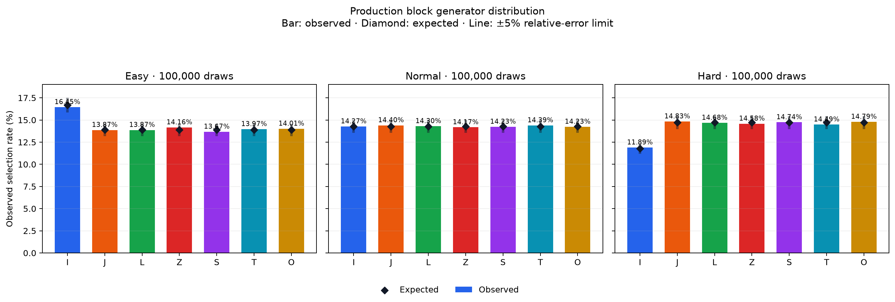
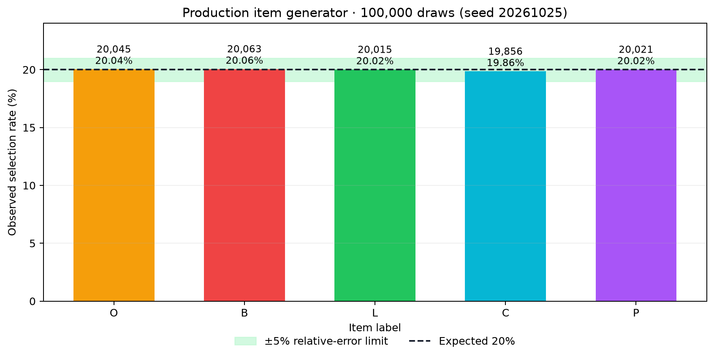

# 검증 보고서

이 문서는 요구사항 1·2 구현에 대한 자동검증과 공개 배포본 인수 결과를 연결한다.

공식 제출 환경은 **macOS 26 이상**이다.

## 1. 대상과 환경

| 항목 | 값 |
|---|---|
| 검증일 | 2026-10-26~27 |
| 공개 릴리스 | [`v0.1.0-req2.3`](https://github.com/HoroyoiPeach/SeoulTech-SE-Tetris-Ref/releases/tag/v0.1.0-req2.3) |
| 태그 커밋 | `10d7b78` |
| 제품 커밋 | `154fd097deff2675e7030f607b0ceeb35b9e69c5` |
| 실행 환경 | macOS 26.6.2 · Apple M1 · RAM 8GB · 여유 디스크 약 28.4GiB |
| Java | 공개 앱 동봉 runtime 21.0.13 |
| 연속 실행 설정 | 600X500 · Normal 팔레트 · Easy 난이도 |

실행용 ZIP을 공개 릴리스에서 내려받아 Finder에서 압축을 풀었다.

앱은 별도 Java 설치나 명령 입력 없이 실행됐다.

실행용 ZIP과 최종 제출용 ZIP에 포함된 앱의 파일 내용·권한·심볼릭 링크도 대조했다.

[검증 요약](evidence/release-acceptance-20261027/summary.json)과 [다운로드 대조 기록](evidence/release-acceptance-20261027/download-verification.json)에 대상과 해시를 기록했다.

실행 환경의 원본 조회값은 [기기 정보](evidence/release-acceptance-20261027/environment.json)에 보관했다.

## 2. 배포 무결성

| 파일 | SHA-256 | CRC |
|---|---|---|
| `seoultech-tetris-v0.1.0-req2.3-macos-aarch64.zip` | `87a8402eb40931f34052c5880f504c33d96c28c37635bca6dde99c616bb2e301` | 통과 |
| `seoultech-tetris-v0.1.0-req2.3-submission.zip` | `b610cc1b95ddd13f4ac67b1db4cec3b9dbad82c5a5da992841bbf8411f94de62` | 통과 |

두 ZIP에 포함된 앱의 394개 엔트리는 경로·내용·권한·심볼릭 링크가 모두 일치했다.

제출 ZIP의 내장 검증기는 소스·98개 테스트 결과·90.08% 커버리지를 정상 대조했다.

## 3. 결과 요약

| 검증 항목 | 결과 | 판정 |
|---|---:|---|
| 빌드 시 JUnit | 98개 실행 · 실패 0 · 오류 0 · 건너뜀 0 | 통과 |
| 빌드 시 Line Coverage | 1,534 / 1,703 = **90.08%** | 70% 기준 통과 |
| 공개 앱 JAR 새 회귀검사 | 50개 성공 · 실패 0 · 중단 0 · 건너뜀 0 | 통과 |
| 일반 블록 분포 | 3난이도 × 100,000회 · 21개 조합 | 통과 |
| 공개 앱 JAR 아이템 분포 | 100,000회 · 5종 | 통과 |
| 공개 앱 GUI 기능 | 실행·메뉴·입력·저장·순위·초기화·5종 아이템 | 통과 |
| Classic 연속 실행 | 310.121초 · 254회 상태 관찰 | 통과 |
| Item 연속 실행 | 310.129초 · 254회 상태 관찰 | 통과 |

98개는 빌드 당시 전체 회귀검사다.

50개는 공개 앱의 번들 JAR을 대상으로 다시 실행한 아이템·공급·모드 기록 중심 검사다.

두 집합에는 겹치는 사례가 있으므로 **148개로 합산하지 않는다**.

## 4. 단위·회귀 검사와 커버리지

제품 커밋 빌드에서 JUnit 98개가 모두 통과했다.

난이도·아이템 효과·공급·모드별 기록·설정 저장·예외 처리와 기존 기능 회귀를 포함한다.

JaCoCo Line Coverage는 1,534 / 1,703, **90.08%**다.

중간평가 50%와 기말평가 70% 기준을 모두 넘는다.

- [빌드 검증 요약](evidence/req12-154fd09-local/summary.json)
- [JUnit XML](evidence/req12-154fd09-local/junit/)
- [JaCoCo XML](evidence/req12-154fd09-local/coverage/jacocoTestReport.xml)

공개 앱에 포함된 제품 JAR에서는 관련 테스트 소스만 다시 컴파일해 50개 검사를 새로 실행했다.

제품 클래스는 다시 컴파일하지 않았다.

검사한 제품 JAR의 SHA-256은 `f33dfabf6b4d8be03e8213a883dc00cb93aa4e016e3378d2bd918f8aa051478e`다.

[새 실행 로그](evidence/release-acceptance-20261027/fresh-headless/test-run-2.log)에 16개 컨테이너와 50개 테스트의 성공 결과가 남아 있다.

[검사 실행기](evidence/release-acceptance-20261027/fresh-headless/ReleaseJUnitRunner.java)도 함께 보관했다.

## 5. 생성 분포

### 일반 블록

실제 게임의 `BlockGenerator`를 Easy·Normal·Hard에서 각각 100,000회 실행했다.

모든 21개 블록·난이도 조합이 기대 확률에 대한 상대오차 5% 이내를 충족했다.

최대 상대오차는 Easy의 Z 블록에서 1.9736%였다.



[분포 원본](evidence/req12-154fd09-local/distribution/block-distribution.csv)에 난이도·기대 확률·관측값·판정을 보관했다.

### 아이템

공개 앱의 번들 JAR에 포함된 실제 아이템 생성기를 100,000회 실행했다.

L·O·C·B·P의 기대 확률은 각각 20%다.

| 아이템 | 관측 횟수 | 관측 확률 | 상대오차 |
|---|---:|---:|---:|
| O | 20,045 | 20.045% | 0.225% |
| B | 20,063 | 20.063% | 0.315% |
| L | 20,015 | 20.015% | 0.075% |
| C | 19,856 | 19.856% | 0.720% |
| P | 20,021 | 20.021% | 0.105% |

다섯 아이템이 모두 상대오차 5% 이내를 충족했다.

100,000회 검사는 원문의 최소 반복 수 1,000회 이상 조건을 충족한다.



[새 분포 CSV](evidence/release-acceptance-20261027/fresh-headless/item-distribution.csv)에 seed와 판정을 보관했다.

두 그래프의 허용 구간은 기대 확률에 대한 상대오차 5% 범위다.

통계적 신뢰구간을 뜻하지 않는다.

```text
상대오차(%) = |관측 확률 - 기대 확률| / 기대 확률 × 100
통과 조건 = 상대오차 5% 이하
```

## 6. 공개 앱 GUI 인수검사

실제 공개 ZIP의 앱을 Finder에서 실행하고 컴퓨터 유즈의 키보드·마우스 입력으로 다음 항목을 확인했다.

[M01~M08 인수 기록](evidence/manual-acceptance.csv)에 절차·관찰 결과·검증 환경과 증빙을 연결했다.

- 시작 메뉴 순환과 Classic·Item·설정·순위 진입 및 복귀
- 이동·회전·낙하·일시정지·재개와 정지 중 게임 입력 차단
- 점수 영역 클릭 후에도 두 모드의 키 입력 유지
- 예약키·중복키 거부와 변경키 저장·재실행 후 복원
- 설정과 모드별 순위의 저장·재실행 후 복원
- 설정 초기화와 순위 초기화의 독립 동작
- 게임오버·이름 입력·10자 제한·빈 이름 기본값
- O·B·C·L·P의 표시·고정·효과와 다음 블록 진행

5종 아이템은 자연 플레이 중 실제 화면에서 관찰했다.

| 아이템 | 확인한 결과 | 대표 화면 |
|---|---|---|
| O | 4×2 형상, 접촉 후 아래 블록 제거, 다음 블록 진행 | [접촉](evidence/release-acceptance-20261027/gui/37-anchor-contact.jpg) · [완료](evidence/release-acceptance-20261027/gui/38-anchor-finished.jpg) |
| B | 회전 불가, 주변 범위 삭제, 남은 블록 정착 | [효과 전](evidence/release-acceptance-20261027/gui/42-b-rotation.jpg) · [효과 후](evidence/release-acceptance-20261027/gui/43-b-after-effect.jpg) |
| C | 지정 열 삭제와 남은 블록 정착 | [효과 전](evidence/release-acceptance-20261027/gui/47-item-watch.jpg) · [효과 후](evidence/release-acceptance-20261027/gui/48-c-after-effect.jpg) |
| L | 미완성 행 삭제와 위 행 압축 | [효과 전](evidence/release-acceptance-20261027/gui/50-l-before-effect.jpg) · [효과 후](evidence/release-acceptance-20261027/gui/51-l-after-effect.jpg) |
| P | 두 행·두 열 삭제, 300점, 반복 공급 후 재사용 | [효과 전](evidence/release-acceptance-20261027/gui/33-p-before-effect.jpg) · [완료](evidence/release-acceptance-20261027/gui/35-p-effect-complete.jpg) · [반복](evidence/release-acceptance-20261027/gui/45-p-repeat.jpg) |

## 7. 두 모드 연속 실행

Classic와 Item을 각각 독립된 새 게임에서 5분 10초 이상 일시정지 없이 실행했다.

자연 낙하를 유지하고 화면에 보이는 셀을 기준으로 회전·좌우 이동을 입력했다.

두 모드의 시간을 합치거나 중단 전후를 이어 붙이지 않았다.

| 확인 항목 | Classic | Item |
|---|---:|---:|
| 실제 상태 관찰 시간 | 310.121초 | 310.129초 |
| 상태 기록 | 254회 | 254회 |
| 최대 기록 간격 | 6.361초 | 7.014초 |
| 입력 묶음 / 키 수 | 18 / 71 | 15 / 53 |
| 점수 변화 | 0 → 692 | 0 → 592 |
| 일시정지 / 게임오버 | 0 / 0 | 0 / 0 |

전체 구간에서 보드·점수·MENU가 표시됐다.

점수는 단조 증가했고 보드 상태가 계속 변했다.

시작과 종료 모두 활성 게임 화면이었다.

- [검산 결과](evidence/release-acceptance-20261027/final-continuous/verified-summary.json)
- [Classic 상태 로그](evidence/release-acceptance-20261027/final-continuous/classic-attempt-2.jsonl)
- [Item 상태 로그](evidence/release-acceptance-20261027/final-continuous/item-attempt-1.jsonl)
- Classic [시작](evidence/release-acceptance-20261027/final-continuous/screenshots/classic-attempt-2-000.jpg) · [종료](evidence/release-acceptance-20261027/final-continuous/screenshots/classic-attempt-2-023.jpg)
- Item [시작](evidence/release-acceptance-20261027/final-continuous/screenshots/item-attempt-1-000.jpg) · [종료](evidence/release-acceptance-20261027/final-continuous/screenshots/item-attempt-1-023.jpg)

검사 종료 후 앱 프로세스가 종료됐고 검사 전 설정·점수 파일을 복원했다.

[복원 확인](evidence/release-acceptance-20261027/final-continuous/final-check.json)에서 두 파일의 SHA-256 일치와 Git 상태 불변을 확인했다.

## 8. 재검산 방법

제품 커밋의 빌드·테스트·커버리지·GUI 자동검사·패키징은 다음 명령으로 실행한다.

```bash
./gradlew --no-daemon --console=plain build desktopSmoke packageRelease
```

보관한 XML·CSV의 수치와 해시는 저장소 루트에서 다시 대조할 수 있다.

```bash
python3 docs/evidence/req12-154fd09-local/verify.py
```

분포 그래프는 다음 명령으로 재생성한다.

```bash
uv run --with matplotlib==3.11.2 python docs/evidence/req12-154fd09-local/plot.py
```

Matplotlib은 그래프 재생성에만 사용하며 제품 의존성에는 포함하지 않는다.

## 9. 판정 범위

이 보고서의 통과 판정은 공개 arm64 macOS 앱, 위 기기, 600X500 설정에서 확인한 결과다.

자동 렌더링과 실제 GUI 표본으로 4개 팔레트의 동작을 확인했다.

실제 색각 이상 사용자를 대상으로 한 구분성 평가는 수행하지 않았다.

핵심 판정 연산 검사와 두 모드 연속 실행은 완료했다.

CPU 1.2GHz·RAM 1GB의 최저 사양 기기에서 정량 성능을 별도로 측정한 결과는 아니다.

Windows와 Intel Mac은 공식 제출 검증 범위에 포함하지 않는다.

## 관련 문서

- [요구사항 1 체크리스트](requirements-1-checklist.md)
- [요구사항 2 체크리스트](requirements-2-checklist.md)
- [게임 명세서](specification.md)
- [사용자 안내서](user-guide.md)
- [개발 안내서](development.md)
- [프로젝트 관리 기록](project-management.md)
